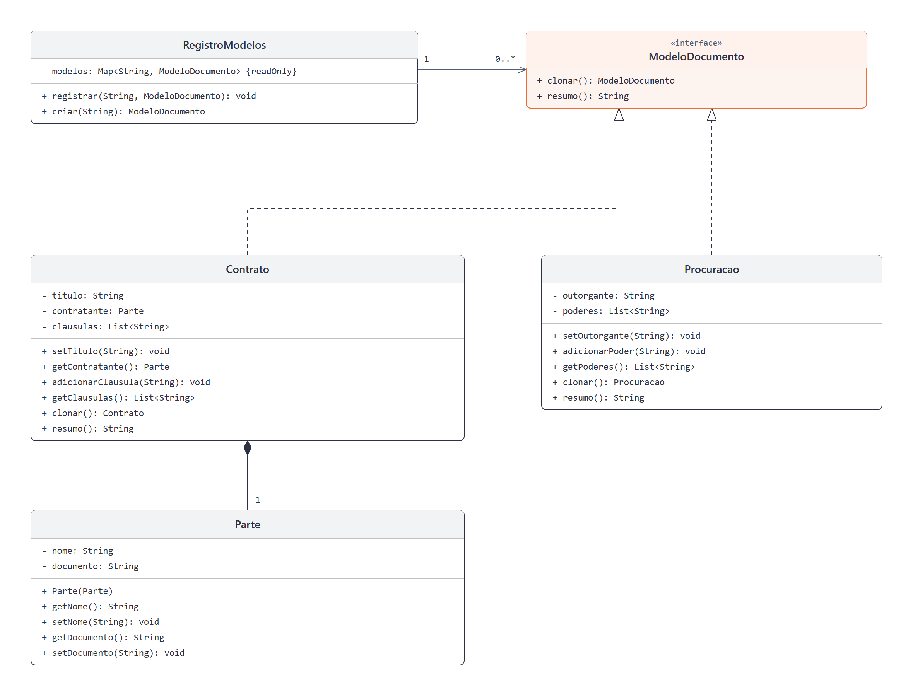

# DCC078 - Padrões de Projeto: Prototype

**Aluno:** Felipe Lazzarini Cunha

## Tema

O projeto representa um escritório que mantém modelos de documentos, como contratos e procurações, e os reutiliza para gerar novos documentos. O Prototype cria cada documento clonando um modelo já configurado, com cópia profunda das partes e listas internas, e um registro entrega as cópias pelo nome do modelo.

## Diagrama de Classes UML



## Estrutura do Projeto

- `ModeloDocumento`: interface do protótipo, com a operação `clonar()`.
- `Contrato` e `Procuracao`: protótipos concretos que copiam seu próprio estado.
- `Parte`: objeto mutável contido em `Contrato`, copiado em profundidade.
- `RegistroModelos`: cliente que guarda os modelos e devolve clones.

## Testes

Com JDK 11 ou superior e Maven:

```bash
mvn test
```
